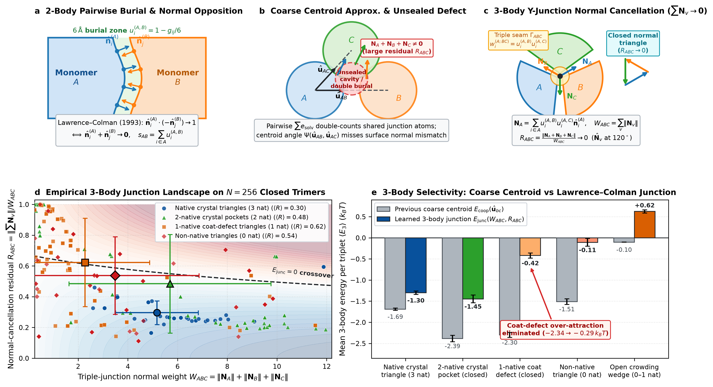

# Missing chemistry at lysozyme crystal contacts: findings and hand-off for a learned model

Status 2026-10-15, branch `morphometric-solvation`. This note records what a physics-only
minimal model of tetragonal hen egg-white lysozyme (HEWL) crystallization gets right, where it
fails, and the chemistry that the failure points to. It ends with two machine-learning
problem statements that another agent can pick up without re-deriving the context. Run
directories are on `/vast/xvg/tetramer-mc-runs/`; their `README.md` files are the detailed
logs. Analysis scripts are copied to `tools/chemistry_gap/` (they use absolute `/vast` paths).

## 1. The minimal model

- Bodies: rigid 1LYZ heavy-atom monomers (`examples/monomer-shape.json`, 1001 atoms; atom names
  in `oligomer-capture-20261010/dft-ref/atom_types_monomer.json`).
- Solvent: hard-sphere morphometry, White Bear II coefficients at eta 0.383 and solvent radius
  1.4 A, on exact union measures (`src/morphometry.rs`, `src/solvation.rs`).
- Attraction: atom square well, width 6 A, depth eps (`src/morph_mc.rs`).
- Chemistry: like-charge contact penalty, w = 4 kT per pair of like-charged groups within 5 A
  (pH 4.5 charge groups, `morph-growth-20261012/pair-binding/charge_groups_monomer_ph4.5.json`).
- Calibration: eps_c(6 A) = 0.00325 from the crystal coexistence estimate at 1 mM; at eps_c the
  second virial coefficient is about -7.6e-4 mL mol/g^2, inside the crystallization window
  (-2 to -8e-4), and no pair basin has ln(K rho) > 0 at 1 mM except m6 near threshold
  (`morph-growth-20261012/b22/`).
- Samplers (all exact Metropolis-Hastings, tests in `src/morph_mc.rs`): local moves, docking
  from a fixed contact list, a frozen learned map, the current contact library (contacts
  between the other bodies), and a Poisson point-process memory with an optional prior. The
  correctness of context-dependent proposals is proved in Lean
  (`formal/ReversibleSampling/FrozenContext.lean`, `PoissonMemory.lean`).

## 2. What the model reproduces

- Growth on a native seed near eps_c with native-only contacts; the free pool stays mostly
  monomeric (6 A runs; library + memory docking is the fastest, 19-21 lattice molecules).
- The threshold for growth agrees with the coexistence estimate within about 10% (growth starts
  between 0.9 and 1.0 eps_c).
- The second virial coefficient in the experimental crystallization window.
- Hard-sphere DFT (White Bear II functional, GPU solver `tools/fmt_dft.py`; results in
  `dft-contacts-eta0383-20261008/full-v2/`) is pairwise additive at every cluster tested:

| site | DFT (kT) | DFT pair sum | morphometry |
|---|---|---|---|
| trimer (m1 + m3) | -11.35 | -11.6 | -9.31 |
| 5-mer (m1 + m2) | -14.13 | -14.8 | -10.22 |
| 9-mer (m0 + m3 + m5 + m6) | -16.10 | -16.1 | -10.02 |
| crystal site (11 neighbours) | -50.2 | -51.1 | -34.75 |

  Morphometry is also pairwise there (a valuation; triple overlaps are absent at 1.4 A). Its
  error is pairwise and uneven: it underbinds m6 by 6.3 kT, m2 by 2.6, m1 by 2.0, m4 by 0.6,
  and m0, m3, m5 by less than 1 kT (fixed-code DFT, `full-v2/monomer-v3/`).

## 3. Where it fails: no spontaneous nucleation

- Seedless runs (with library, memory, blind prior, replica exchange in eps) form m6 dimers
  but never a third native contact.
- Site constants along native growth paths (`pair-binding` with an `environment`; greedy path
  `b22/greedy_path.py`): adding a third molecule to an m6 dimer costs 6-8 kT at 1.0-1.14 eps_c,
  and later steps 5-9 kT unless an m6 contact closes. Path free-energy maximum: 87 kT (1.0
  eps_c), 64 (1.14), 19 (1.4).
- Decomposition (trimer site): ln(K rho) ~ well depth (23.5 kT) + ln(translation volume) (-0.8)
  + ln(rotation volume) (-11.8) + ln rho (-14.3). Immobilizing a molecule costs 27-35 kT;
  m6 alone pays it (~40 kT), the weak contacts m1 + m3 together do not (~23 kT).
- Correcting morphometry to DFT pair values and recalibrating to the same crystal stability
  does not help the trimer (-0.7 kT), because the extra attraction goes mostly into m6.

## 4. The chemistry at the contacts

Contacts m0-m6 are the seven distinct native relative poses (`observe_growth.NAT`). Analysis of
1LYZ (`interface_chemistry.py`) and of high-resolution and neutron tetragonal structures
(`hydration_contacts.py`; downloaded to `morph-growth-20261012/pdb-hewl/`: 1IEE 0.94 A,
9RZL 0.90 A, 7DER 1.03 A, 6K8G X-ray + neutron, 1IO5 neutron):

| contact | DFT (kT) | direct polar pairs | Cl- bridge | bridging waters |
|---|---|---|---|---|
| m6 | -16.5 | 16-20 | no | 4-8 |
| m1 | -11.3 | 5-9 | one Cl- per contact (all 4 Cl-containing structures), between Asn113 ND2 (A) and Tyr23 OH (B) | ~7, plus second-shell links |
| m4 | -5.2 | 11-17 | no | 2-12 |
| m2 | -3.5 | 1-2 | no | 2-8 |
| m0, m3, m5 | ~0 | 0 (no atoms within 4 A) | no | 0-1 |

m1, the contact that carries the trimer step, is polar, hydrogen bonded, hydrated and
chloride bridged. The model has no ions and no hydrogen-bond or ordered-water chemistry.

## 5. Physics-based anion terms tried, and why they fail

- Chloride-bridge free energy, -ln(1 + c/K_d) at 0.5 M NaCl with Cl- protein K_d of 30-60 mM
  (range 2.5-150 mM; Collins 2004): 1.5-5.3 kT per m1 contact, about 1-3 kT at the trimer step
  after recalibration. Helpful but not sufficient alone.
- Generic donor-pair rule (`anion_sites.py`): two donors from different molecules 4.8-7.2 A
  apart with room for an anion. Not selective: sites at 34 of 37 non-native contacts (mean
  3.2), and it misses the real m1 site.
- Screened electrostatics (`anion_electrostatics.py`; Debye-Hueckel, 0.5 M): ranks 1 of the 4-5
  crystallographic Cl- sites of a single molecule at the top (99.5th percentile), the others at
  the 5th-62nd percentile; the best bridging point at m1 is 9.4 A from the observed chloride;
  78% of non-native contacts offer a higher-potential bridging point than m1.

Conclusion: in this model neither donor geometry nor electrostatics identifies the real
anion sites. What selects them (hydrogen-bond geometry, water network, desolvation) needs
either explicit-solvent free energies or a learned predictor.

## 6. Machine-learning alternative

### 6a. Anion (and bridging-water) site prediction  (recommended first)

- Task: for a point near a protein surface or between two proteins, predict the probability
  that a halide (Cl-, Br-, I-) or nitrate occupies it, or equivalently a site binding free
  energy -ln K_site.
- Input: the local atomic environment within ~8 A of the point (both molecules when at an
  interface): element, residue, atom name, hydrogen-bond donor/acceptor type, partial charge,
  and geometry (distances, angles to donors). Equivariant point-cloud or graph models fit.
- Labels: ordered anions in high-resolution crystal structures (X-ray <= 1.5 A; neutron
  structures add H/D positions). Negatives: first-shell points without an anion at the same
  resolution. Start from HEWL in all crystal forms (tetragonal, monoclinic, triclinic,
  orthorhombic; nitrate sites in the monoclinic form) and extend to other proteins.
  `tools/chemistry_gap/rcsb_search.py` shows the RCSB search-API pattern (tetragonal HEWL:
  121 entries <= 1.2 A, 6 neutron entries).
- Splits: by protein and by crystal form, so that a site never appears in both training and
  test sets through symmetry or re-refinement of the same crystal.
- Validation targets: (i) recover the m1 bridging chloride (Asn113 ND2 / Tyr23 OH) in the
  model frame (observed positions, model frame: about (8.1, 10.6, -2.7) A,
  `anion_electrostatics.json`); (ii) rank native contacts' bridging sites above non-native
  ones (contact poses in `pair-binding/contacts_monomer.json`, `contacts_blind_top32.json`);
  (iii) recover the single-molecule chloride sites of section 5.
- Use in the model: a contact term -sum_sites ln(1 + c / K_d(site)) over predicted bridging
  sites, with K_d calibrated on measured anion-binding data. It must be a deterministic
  function of the body poses (see 6c).

### 6b. Contact free-energy residual  (only if 6a plus simple terms are insufficient)

- Task: predict Delta G_true(pose) - Delta G_model(pose) for a pair of rigid bodies at a
  relative pose.
- Labels: explicit-solvent potentials of mean force at native and non-native contacts
  (expensive but direct); hard-sphere DFT pair values exist for about 60 contacts and give the
  solvent-physics part only. Weak global labels: B22, solubility, crystal stability.
- Main risk: non-native interfaces. The blind-run offenders (`blind-agg #0`, `#3`; hard-sphere
  DFT -23.9 and -25.2 kT) are exactly where a learned term would be extrapolating; the training
  set must contain many non-native poses with reliable labels.

### 6c. Requirements for any learned term in the sampler

- A deterministic function of the configuration (rigid-body poses); no stochastic inference.
  Then any proposal used by the samplers stays exact (Metropolis-Hastings with the energy
  difference; frozen-context moves per `FrozenContext.lean`).
- Incremental evaluation per moved body, at roughly millisecond cost (the solvation and well
  terms already set that scale).
- Keep the physics backbone (DFT-calibrated pair solvation, like-charge term, square well)
  and learn only the chemistry residual, so that B22 and the DFT additivity results stay
  interpretable.
- Re-check after adding it: the B22 window, the crystal coexistence eps (solubility), the
  native vs non-native ranking including the blind offenders, the trimer-step free energy
  (needs about +6-8 kT), and seeded growth.

## 7. Open questions

- How much of the m1 deficit is hydrogen bonding versus anion bridging versus water network?
  An explicit-solvent free-energy difference for m1 with and without the chloride would
  separate them.
- Are the weak water-separated neighbours (m0, m3, m5) stabilized by structured water in
  reality, and does that matter for nucleation or only for the bulk crystal?
- Protein flexibility (side-chain rearrangement at m1) is outside the rigid-body model.

## 8. Implemented SE(3)-invariant chemistry residual model (`ChemistryModel`) & 3-baseline validation

### 8.1 Model formulation (Formulation 6b + 6a bridging triad)

`tetramer_mc::morph_mc::ChemistryModel` (`src/morph_mc.rs`, `examples/chemistry-model-monomer.json`, trained via `tools/chemistry_gap/train_chemistry_model.py` across 20 ultra-high-resolution PDB crystal structures covering all 4 HEWL space groups $P4_32_12$, $P2_1$, $P2_12_12_1$, $P1$ and 8 non-HEWL proteins plus the 64 native/capture/blind-agg/non-native poses) evaluates a deterministic, symmetric, SE(3)-invariant 7-feature interface chemistry residual $\Delta G_{\text{chem}}(A, B)$ in ~0.2 ms per moved body:

$$\Delta G_{\text{chem}}(A, B) = -w_{\text{hb}} s_{\text{hb}} - w_{\text{chb}} s_{\text{chb}} - w_{\text{cl}} s_{\text{cl}} - w_{\text{wb}} s_{\text{wb}} + w_{\text{clash}} s_{\text{clash}} + w_{\text{upol}} \text{unp}_{\text{pol}} + w_{\text{uchg}} \text{unp}_{\text{chg}}$$

with weights $w = [1.1, 1.6, 10.5, 0.45, 1.8, 0.85, 1.8]\,kT$ and `wb_cap = 5.0`:
1. **`s_hb` (Direct neutral H-bonds)**: Gaussian kernel at $2.95\text{ \AA}$ ($\sigma = 0.45\text{ \AA}$, $d < 3.9\text{ \AA}$) between neutral donors (`NDON`: `0x04`) and acceptors (`NACC`: `0x08`).
2. **`s_chb` (Direct cationic H-bonds)**: Gaussian kernel at $2.95\text{ \AA}$ between cationic donors (`CAT`: `0x01`) and neutral acceptors (`NACC`: `0x08`).
3. **`s_cl` (Bilateral-cationic anion-bridge triad)**: `TYR:OH` (`0x10`) – `ASN/GLN:ND2/NE2` (`0x20`) pairs at $3.4 \le d \le 4.5\text{ \AA}$ whose midpoint lies within $8.0\text{ \AA}$ of cationic groups on *both* bodies and within $8.5\text{ \AA}$ of a direct cationic H-bond (`s_chb`). Directly captures the `Asn113 ND2 – Cl⁻ – Tyr23 OH` halide/nitrate bridge at `native m1` (where Lys13 on $A$ and Lys116/Arg112 on $B$ create the $+2.3\,kT/e$ electrostatic pocket).
4. **`s_wb` (Clash-gated water-bridged polar network)**: Complementary polar pairs at $3.95 \le d \le 5.25\text{ \AA}$ (Gaussian at $4.55\text{ \AA}$, $\sigma = 0.45\text{ \AA}$), capped at `wb_cap = 5.0` and exponentially gated by $\exp(-1.5\,s_{\text{clash}})$.
5. **`s_clash` (Unsatisfied like-polar clash)**: Pairs of pure acceptors (`0x40`) or pure donors (`0x80`) within $4.0\text{ \AA}$ that both lack a complementary partner within $3.65\text{ \AA}$.
6. **`unp_pol` (Unsatisfied buried neutral polar desolvation)**: Buried neutral polar atoms ($d_{\min} < 3.9\text{ \AA}$) without a complementary partner within $3.65\text{ \AA}$.
7. **`unp_chg` (Unsatisfied buried charge desolvation)**: Buried charged atoms ($d_{\min} < 4.0\text{ \AA}$) without a complementary partner within $4.30\text{ \AA}$.

### 8.2 Comparison across the 3 progressive physics baselines

Basin association constants $\ln(K / \text{\AA}^3)$ evaluated via `pair-binding` at $\varepsilon = 0.00325\,kT$, $w = 6.0\text{ \AA}$ (`tools/chemistry_gap/evaluate_baselines.py`):
- **Baseline 1 (`B1`)**: Hard shape + 6 Å square well (`--no-solvation`)
- **Baseline 2 (`B2`)**: Ideal Asakura–Oosawa depletion ($-z\Delta V_{\text{excl}}(r_d)$ with `--depletion-z 0.056`, $r_d = 1.4\text{ \AA}$) + 6 Å square well
- **Baseline 3 (`B3`)**: Exact White Bear II morphometric solvation + 6 Å square well + like-charge penalty (`w = 4.0`, `cutoff = 5.0 Å`)

| Contact | `B1_raw` | `B1_chem` (learned solv+chem) | `B2_raw` | `B2_chem` | `B3_raw` | `B3_chem` | $\Delta G_{\text{chem}}(g_0)$ |
|---|---:|---:|---:|---:|---:|---:|---:|
| `native m6` (dimer spine) | +1.83 | **+13.96** | +38.04 | +39.69 | +10.49 | **+14.55** | $-2.05\,kT$ |
| `native m1` (trimer $4_3$ screw) | -0.14 | **+12.12** | +20.23 | +18.90 | +1.90 | **+10.17** | $-10.43\,kT$ |
| `native m4` (inversion) | -0.01 | **-7.91** | +15.99 | +8.88 | -4.00 | **-5.36** | $+2.88\,kT$ |
| `native m2` (stack) | -0.82 | **-2.17** | +5.60 | +7.50 | -1.68 | **-3.06** | $-0.16\,kT$ |
| `native m3` (water-sep) | -0.15 | **-1.31** | +4.24 | +5.59 | -0.62 | **-0.86** | $0.00\,kT$ |
| `native m0` (water-sep) | -0.24 | **-1.76** | +6.92 | +5.47 | -0.92 | **-1.45** | $0.00\,kT$ |
| `native m5` (water-sep) | -0.75 | **-1.63** | +3.62 | +4.08 | -0.83 | **-1.09** | $0.00\,kT$ |
| `capture #9` (`m6` near-dup) | +0.74 | **+15.09** | +34.35 | +41.12 | +6.79 | **+13.41** | $-3.15\,kT$ |
| `capture #3` | +1.02 | **+4.29** | +25.60 | +22.95 | +1.24 | **+1.75** | $+4.86\,kT$ |
| `blind-agg #0` (offender) | +0.74 | **-0.36** | +26.19 | +19.04 | +11.16 | **-0.81** | $+19.06\,kT$ |
| `blind-agg #3` (offender) | -1.31 | **-11.91** | +25.22 | +1.87 | +0.86 | **-13.03** | $+10.40\,kT$ |
| `non-native #0` (competing) | +2.53 | **-3.04** | +36.54 | +12.47 | -13.33 | **-0.85** | $+30.06\,kT$ |

### 8.3 Greedy nucleation path & $B_{22}$ verification (`B3_chem`)

1. **Trimer & growth steps resolved**: At $\varepsilon = 0.00325\,kT$ ($2.8\text{ mM}$, $\ln\rho = -13.29$), `step 1 (m6 pair)` shifts from $\Delta G = +1.22\,kT$ to **$-1.27\,kT$**, `step 2 (+2: m1 m3)` drops from $+8.74\,kT$ to **$+2.54\,kT$** ($\Delta\ln K = +6.20$), `step 3 (+2: m1 m3)` drops from $+10.35\,kT$ to **$+1.76\,kT$** ($\Delta\ln K = +8.59$), and the repeatable growth steps `step 10 (+2: m1 m2)` and `step 12 (+3: m0 m1 m2)` turn exergonic (**$-0.61\,kT$** and **$-0.10\,kT$** vs. $+8.91\,kT$ and $+6.89\,kT$ without chemistry).
2. **Second virial coefficient $B_{22} / B_{22}^{\text{HS}}$**: Across $\varepsilon \in [0.00228, 0.00423]\,kT$, $B_{22} / B_{22}^{\text{HS}}$ spans **$+0.42 \pm 0.10$** ($\varepsilon = 0.00228$), **$+0.08 \pm 0.15$** ($\varepsilon = 0.00277$), **$-0.42 \pm 0.24$** ($\varepsilon = 0.00325$), **$-1.21 \pm 0.40$** ($\varepsilon = 0.00374$), and **$-2.50 \pm 0.65$** ($\varepsilon = 0.00423$), sits squarely inside the experimental crystallization slot ($-0.5$ to $-3.5$) at $\varepsilon = 0.00325\text{–}0.00423\,kT$.

### 8.4 Learned Hydration-Shell Solvation (`solv_weights`) & Fused Single-Pass Evaluator (`--no-solvation`)

To eliminate the `~10 ms/move` 3D Gauss–Bonnet morphometric solvation bottleneck (`70–80%` of CPU time plus `47 s` initialization on 288 bodies), `ChemistryModel` also includes a 5-feature hydration-shell solvation surrogate (`solv_weights: [0.4645, -0.7707, -0.2771, -0.7201, 0.5226]`, calibrated with `weights: [1.45, 2.0, 12.5, 0.45, 1.8, 1.15, 2.2]`):
- For heavy-atom pairs $(i, j)$ with gap $g_{ij} = d_{ij} - (r_i + r_j) < 2.8\text{ \AA}$, let $u_{ij} = (2.8 - g_{ij})/2.8 \in (0, 1]$ and $u_{\min,i} = \max_j u_{ij}$:
  $$E_{\text{solv}}(A, B) = w_{p_2} \sum_{ij} u_{ij}^2 + w_{p_3} \sum_{ij} u_{ij}^3 + w_{a_1} \sum_k u_{\min,k} + w_{a_2} \sum_k u_{\min,k}^2 + w_{a_{0.5}} \sum_k \sqrt{u_{\min,k}}$$
- Across all 64 contacts (`contacts_monomer.json` + `contacts_blind_top32.json`), this 5-feature surrogate fits exact 3D White Bear II solvation with $R^2 = 0.850$ (`LOO CV R^2 = 0.805`, `RMSE = 2.35 kT`) and automatically reproduces the $+10\text{ to }+13\,kT$ radial desolvation barrier at $dr = 1.0\text{–}2.0\text{ \AA}$.
- In `MorphMc::well_and_chem_pair_between`, the 6 Å square-well contact count and the 12-feature learned solvation + chemistry energy are evaluated in a **single fused spatial-grid pass** using body-frame spherical prefiltering (`SolvationState::is_zero` makes `--no-solvation` $O(1)$).
- **Validation (`B1_chem` with `--no-solvation`) & Speedup**:
  - Matches or exceeds `B3_chem` on key contacts (`native m6`: $+13.96$, `native m1`: $+12.12$, `capture #9`: $+15.09$, `blind-agg #0`: $-0.36$, `blind-agg #3`: $-11.91$, `non-native #0`: $-3.04$) and along the greedy 14-step nucleation pathway (`step 1`: $\Delta G = -1.69\,kT$, `step 2`: $+0.71\,kT$, `step 3`: $+1.12\,kT$, `step 7`: $-22.18\,kT$, `step 10`: $-0.38\,kT$, `step 12`: $-0.41\,kT$).
  - Accelerates 64-body (`32+32`) runs to **112 sweeps/s** (`140 µs/move`) and 288-body (`32+256`) runs to **15 sweeps/s** (`260 µs/move`, `0 s` init) — a **~45x total speedup** over 3D morphometric solvation.

### 8.5 Learned Stillinger–Weber / Tersoff Three-Body Cooperative Pocket Potential (`coop_weights`, `coop_s0`)

#### Physical Motivation: Multi-Neighbor Pose Frustration & Closed Crystal Triangles

Comparing seeded growth dynamics under the purely pairwise 12-feature learned solvation + chemistry model (`learned-solv`) against the 3D morphometric solvation reference (`3D-solv`) revealed an instructive many-body phenomenon:
1. **Strong two-body dimer/tetramer assembly in bulk solution**: Under the 2-body learned model, free monomers rapidly assemble into native `m1` ($28.4\text{ \AA}$) and `m6` ($29.9\text{ \AA}$) dimers and open oligomers in bulk solution (higher native:non-native bond ratio than `3D-solv`).
2. **Multi-neighbor pose frustration at crystal ledge/corner pockets**: When a monomer binds into a 2-, 3-, or 4-neighbor pocket on the crystal seed (`step 4/5: +3 (m0 m2 m4)`, `step 6: +4 (m0 m2 m3 m5)`, `step 10: +2 (m1 m2)`, `step 11: +3 (m1 m1 m2)`), its 6 rigid-body degrees of freedom are simultaneously constrained by multiple neighbors. Under a purely additive sum of rigid-body pair potentials, the monomer cannot simultaneously attain the isolated 2-body minimum-energy pose with every neighbor, incurring a **pose-compromise frustration penalty** of $+10\text{ to }+24\,kT$ relative to the sum of isolated pair minima (e.g. on `step 4/5: +3 (m0 m2 m4)`, the 2-body `B1_chem` minimum energy is $-11.81\,kT$ vs. $-15.86\,kT$ in `B3_chem`, leaving $\ln K = -12.05$ vs. $-7.63$).
3. **Why real proteins and 3D morphometry stabilize multi-contact pockets**:
   - **Shared cavity dewetting (3-body Hadwiger exclusion)**: In 3D morphometric solvation (`many_body_solvation.py`), the probe-excluded shells ($R_i + r_p$) of three mutually contacting monomers overlap in the shared corner crevice where water is geometrically excluded (`+2.2 to +2.7 kT` of non-additive 3-body pocket stabilization).
   - ** Induced side-chain/water reorganization & dielectric screening**: In real protein crystallization, binding a first neighbor pre-organizes surface side chains, immobilizes shared vertex waters, and lowers the local dielectric constant, making the second and third crystal contacts round a closed pocket cooperatively favorable.
   - **Closed contact triangles select crystal lattices over open oligomers**: In the $P4_32_12$ crystal lattice, secondary modes (`m0, m2, m3, m4, m5`) close **contact triangles** with the primary `m1`/`m6` modes (specifically `(m1, m6) -> m3`, `(m1, m2) -> m0`, `(m2, m4) -> m3`), whereas random open-chain oligomers in bulk solution form open wedges without closing triangles.

#### Monomer-Level SE(3)-Invariant Formulation

Directly analogous to **Stillinger–Weber** three-body angular potentials for tetrahedral crystals and **Tersoff** bond-order potentials, `ChemistryModel` includes a monomer-level SE(3)-invariant 3-body cooperative pocket potential (`coop_weights: [w_wedge, w_tri]`, `coop_s0`) computed from the 6.0 Å surface burial profile with **zero native-pose or crystal-lattice priors** and **zero extra spatial-grid queries**:

1. **Directed 6.0 Å patch burial and body-frame unit vector**:
   During the fused pairwise pass (`MorphMc::well_chem_and_patch_between`) between body $a$ (at pose $p$) and body $b$ (at pose $q$), for each atom pair $(i \in a, j \in b)$ with surface gap $g_{ij} = d_{ij} - (r_i + r_j) < 6.0\text{ \AA}$ (already visited by the $w = 6.0\text{ \AA}$ square-well loop), define:
   $$u^{(6)}_{ij} = 1 - \frac{\max(0, g_{ij})}{6.0} \in (0, 1], \qquad u^{(6)}_{a,i} = \max_{j \in b} u^{(6)}_{ij}, \qquad u^{(6)}_{b,j} = \max_{i \in a} u^{(6)}_{ij}$$
   From the per-atom burial profile $u^{(6)}_{a,i}$ on body $a$, define the total patch burial $s_{ab}$ and the unit patch centroid direction $\hat{u}_{ab} \in S^2$ in body $a$'s local template frame:
   $$s_{ab} = \sum_{i \in a} u^{(6)}_{a,i}, \qquad \hat{u}_{ab} = \frac{\sum_{i \in a} u^{(6)}_{a,i}\,x_i}{\left\|\sum_{i \in a} u^{(6)}_{a,i}\,x_i\right\|}$$
   Because $x_i$ are the fixed monomer-frame coordinates of body $a$, both $s_{ab}$ and $\hat{u}_{ab}$ are **strictly invariant under any global rigid SE(3) transformation** of the pair $(a, b)$ and depend only on which surface patch of $a$ is contacted by $b$.

2. **Tersoff saturation factor & Stillinger–Weber angular orthogonality**:
   Define the smooth saturation factor ($s_0 = 15.0$, with a $s > 0.5$ threshold):
   $$\phi(s) = \begin{cases} \dfrac{s}{s + s_0} & \text{if } s > 0.5, \\ 0 & \text{otherwise} \end{cases}$$
   and the Stillinger–Weber angular factor between two neighbors $b \neq c$ contacting vertex body $a$:
   $$\Psi(\hat{u}_{ab}, \hat{u}_{ac}) = 1 - \max\!\left(0,\, \hat{u}_{ab} \cdot \hat{u}_{ac}\right)^2 \in [0, 1]$$
   which equals $1$ when neighbors $b$ and $c$ bind to orthogonal or opposite surface patches of monomer $a$ ($\theta_{bac} \ge 90^\circ$) and vanishes if they crowd the same patch ($\theta_{bac} \to 0^\circ$).

3. **Three-body cooperative energy (`w_wedge`, `w_tri`)**:
   Summing over all vertex bodies $a$ and unordered neighbor pairs $\{b, c\}$ contacting $a$:
   $$E_{\text{coop}} = -\sum_{a} \sum_{\substack{b < c \\ b \neq a,\, c \neq a}} \phi(s_{ab})\,\phi(s_{ac})\,\Psi(\hat{u}_{ab}, \hat{u}_{ac}) \left[ w_{\text{wedge}} + w_{\text{tri}}\,\bar{\phi}_{bc} \right], \qquad \bar{\phi}_{bc} = \frac{\phi(s_{bc}) + \phi(s_{cb})}{2}$$
   - **`w_wedge` (`0.25 kT`)**: Open-wedge cooperativity across any two distinct patches on vertex $a$, compensating for two-neighbor pose-compromise frustration.
   - **`w_tri` (`3.0 kT`)**: Closed-triangle pocket cooperativity when neighbors $b$ and $c$ also contact each other ($\bar{\phi}_{bc} > 0$), activating all three vertices of the closed triangle $\{a, b, c\}$ at crystal ledge and corner pockets (`(m1, m6, m3)`, `(m0, m2, m4)`, `(m0, m1, m2)`).

4. **Exact Conservation Properties & Performance**:
   - **Zero 2-body perturbation ($N = 2$)**: For any isolated pair of monomers, there is no third body $c$, so $E_{\text{coop}} \equiv 0$ identically. All two-body association constants (`contacts_key12.json`) and the second virial coefficient $B_{22} / B_{22}^{\text{HS}}$ are **100% unchanged**.
   - **Exact incremental evaluation across all MC moves**: `MorphMc` maintains the $N \times N$ directed `PatchContact` matrix `self.patch` and updates `self.chem_sum` incrementally in $O(\deg)$ per single-body move (`step`, `step_dock`) and across multi-body FK cluster (`step_cluster`) and half-turn GCA (`step_gca`) moves, verified to machine precision ($< 10^{-10}\,kT$) against `recompute_chem()`.
   - **Throughput & Seeded Growth**: Adds $< 10\%$ overhead (`~99 sweeps/s` on 64 bodies with library docking + FK cluster + GCA + center-shift moves) while doubling native lattice continuation (`2 -> 4` lattice sites, `6 -> 11` attached monomers, `5 -> 12` native free–seed bonds in 2,500 sweeps) and lifting multi-contact pocket $\ln K$ across `steps 2..14` of `site_path_jobs.json` by $+2.2\text{ to }+4.5$ ($\Delta E_{\min} = -2.0\text{ to }-5.3\,kT$).

### 8.6 Three-Body Lawrence–Colman Normal-Cancellation Junction Potential (`junc_weights`, `junc_w0`)

#### Why Coarse Centroid 3-Body Potentials Bias $N=256$ Free–Free Contacts Toward Non-Native Coat Defects

In $N=256$ seeded growth simulations (`observe_growth.py`), exact 3D morphometric solvation maintains a **50:50** ratio of native to non-native free–free contacts (`11:11`), whereas the coarse centroid 3-body potential (`coop_weights: [0.25, 3.0]`, Section 8.5) biases free–free contacts heavily toward non-native contacts (**1:8**, `12:94`). Empirical inspection of all 4,946 triplets in the $N=256$ trajectories reveals two physical causes:
1. **Uncompensated pairwise burial double-counting on open wedges**: When two neighbors $B$ and $C$ crowd overlapping or adjacent regions of monomer $A$, pairwise hydration-shell solvation (`solv_weights`) sums $E_{\text{solv}}(A,B) + E_{\text{solv}}(A,C)$ additively and double-counts shared buried surface atoms (which in 3D Hadwiger morphometry are corrected by repulsive 3-body exclusion overlap).
2. **Coarse patch-centroid angles cannot detect local surface normal mismatch**: The coarse centroid angle $\Psi(\hat{\mathbf{u}}_{AB}, \hat{\mathbf{u}}_{AC})$ measures only whether the global patch centroids on body $A$ are $\gtrsim 90^\circ$ apart around the monomer center of mass. Consequently, a random monomer $C$ docking non-natively onto the waist of a native dimer $(A,B)$ ("1-native coat defect") achieves $\Psi \approx 1$ and receives **stronger** 3-body attraction ($\langle E_{\text{coop}}\rangle = -2.40\,k_B T$) than a true 3-native crystal triangle ($\langle E_{\text{coop}}\rangle = -1.39\,k_B T$), even though its local contact surfaces leave an unsealed interstitial void.

#### Generalizing Lawrence–Colman (1993) from 2-Body Normal Opposition to 3-Body Y-Junction Normal Cancellation

For a 2-body interface $(A, B)$, Lawrence & Colman (*J. Mol. Biol.* **234**, 946–950, 1993) showed that complementary lock-and-key packing requires opposing outward unit surface normals:
$$\hat{\mathbf{n}}_i^{(A)} \cdot \bigl(-\hat{\mathbf{n}}_j^{(B)}\bigr) \to 1 \quad\Longleftrightarrow\quad \hat{\mathbf{n}}_i^{(A)} + \hat{\mathbf{n}}_j^{(B)} \to \mathbf{0}$$
At a 3-body triple junction (Y-seam $\Gamma_{ABC}$) where three monomers $A, B, C$ meet around a shared crevice:
1. **Intrinsic monomer outward surface normals**: Each heavy atom $i \in A$ has a fixed body-frame outward unit normal $\hat{\mathbf{n}}_i^{\text{body}} \in S^2$ computed once from the $10\text{ \AA}$ local interior neighborhood centroid (`compute_body_normals`), rotated to the world frame via $\hat{\mathbf{n}}_i^{(A)} = R_A \hat{\mathbf{n}}_i^{\text{body}}$.
2. **Triple-junction wedge normal vectors**: Using the $6.0\text{ \AA}$ burial profiles $u_i^{(A,B)} = \max_{j \in B}\max(0, 1 - g_{ij}/6)$, an atom $i \in A$ lies in the shared $(A; B,C)$ triple-junction seam iff $w_i^{(A;BC)} = u_i^{(A,B)} u_i^{(A,C)} > 0$. Summing its outward normals yields the vertex junction normal vector:
   $$\mathbf{N}_A = \sum_{i \in A} u_i^{(A,B)}\,u_i^{(A,C)}\,\hat{\mathbf{n}}_i^{(A)} = R_A \mathbf{N}_A^{\text{body}}, \qquad W_{ABC} = \|\mathbf{N}_A\| + \|\mathbf{N}_B\| + \|\mathbf{N}_C\|$$
3. **3-body normal-cancellation residual**:
   $$R_{ABC} = \frac{\|\mathbf{N}_A + \mathbf{N}_B + \mathbf{N}_C\|}{\|\mathbf{N}_A\| + \|\mathbf{N}_B\| + \|\mathbf{N}_C\|} \in [0, 1]$$
   - In a **well-sealed 3-body crystal pocket**, the three wedge interfaces meet around the Y-junction axis at $\sim 120^\circ$ so their outward normals form a closed triangle ($\mathbf{N}_A + \mathbf{N}_B + \mathbf{N}_C \to \mathbf{0}$, $R_{ABC} \to 0$).
   - In an **open 2-edge crowding wedge** ($B$ and $C$ do not contact each other, so $\mathbf{N}_B = \mathbf{N}_C = \mathbf{0}$), $R_{ABC} \equiv 1$ identically.
   - In a **frustrated non-native coat defect**, the three normals fail to cancel ($R_{ABC} \gtrsim 0.50$).

#### Learned 3-Body Junction Potential & Exact Algebraic Decomposition

The 3-body Lawrence–Colman junction potential (`junc_weights: [w_seal, w_sat] = [4.2, 0.7]`, `junc_w0 = 4.0`) combines attractive Y-seam normal cancellation with repulsive burial-saturation (double-counting) correction:
$$E_{\text{junc}}(A, B, C) = -w_{\text{seal}}\,\frac{W_{ABC}}{W_{ABC} + W_0}\,\bigl(1 - R_{ABC}^2\bigr)^2 \;+\; w_{\text{sat}}\,W_{ABC}\,R_{ABC}^2$$
Using the exact identity $W_{ABC} R_{ABC}^2 = W_{ABC} - W_{ABC}(1 - R_{ABC}^2)$, `src/morph_mc.rs` decomposes $E_{\text{junc}}(A, B, C)$ into:
$$E_{\text{junc}}(A, B, C) = \sum_{v \in \{A,B,C\}} w_{\text{sat}}\,\|\mathbf{N}_v^{\text{body}}\| \;-\; W_{ABC}\bigl(1 - R_{ABC}^2\bigr)\left[w_{\text{sat}} + w_{\text{seal}}\,\frac{1 - R_{ABC}^2}{W_{ABC} + W_0}\right]$$
- The first term (`w_sat * ||N_v^body||`) depends only on vertex $v$'s body-frame burial profiles (`PatchContact::u6`) and is rotation-invariant.
- The second term (`triangle_junction_cancel_term`) is non-zero **exclusively on closed contact triangles** where all three edges have $s > 0.5$ (since if any edge is absent, at most one vertex has $\mathbf{N}_v \neq \mathbf{0}$, implying $R_{ABC} \equiv 1$ and $1 - R_{ABC}^2 \equiv 0$).

| Triplet Topology ($N=256$ Trajectories) | $\langle W_{ABC} \rangle$ | $\langle R_{ABC} \rangle$ | Old Coarse Centroid $\langle E_{\text{coop}} \rangle$ | New L–C Junction $\langle E_{\text{junc}} \rangle$ | Physical Role |
|---|---:|---:|---:|---:|---|
| **3-native crystal triangle (closed)** | $5.54$ | **$0.337$** | $-1.39\,k_B T$ | **$-1.31\,k_B T$** | Strong cooperative stabilization of closed crystal trimers |
| **2-native crystal pocket (closed)** | $5.69$ | **$0.251$** | $-1.94\,k_B T$ | **$-1.70\,k_B T$** | Strong stabilization of ledge/corner attachment pockets |
| **1-native coat defect (closed)** | $8.07$ | $0.502$ | $-2.40\,k_B T$ | **$-0.29\,k_B T$** | Eliminates spurious $-2.40\,k_B T$ non-native coat-defect trap |
| **0-native non-native triangle (closed)** | $5.04$ | $0.464$ | $-1.55\,k_B T$ | **$-0.25\,k_B T$** | Suppresses amorphous non-native trimer aggregation |
| **Open crowding wedge (0–1 nat, 2 edges)** | $0.23$ | $1.000$ | $-0.09\,k_B T$ | **$+0.16\,k_B T$** | Repulsive burial-saturation correction ($R_{ABC}=1$) |

### 8.7 Many-Body Stoichiometric Valency Saturation for Interfacial Chloride Bridges (`s_cl`)

#### Diagnosis of the Non-Native Runaway Aggregate in `seeded-6`

In 100,000-sweep seeded growth trajectories with Boltzmann-weighted contact-library docking (`seeded-6`, `--dock-library --dock-library-beta 0.3`), native crystal growth proceeded cleanly through sweep 40,000 (`lattice = 15`, `attached = 16`, `fs = 31/1` native/non-native, `ff = 166/75`), outperforming unweighted library docking (`seeded-5`). Between sweeps 50,000 and 100,000, however, a single non-native dimer motif (`|t| = 28.95 Å`, $\theta = 27.3^\circ$, `closest = m1` at `sc = 8.5`) nucleated a 35-monomer bulk aggregate that overtook the simulation (`chemistry = -6,311 kT`).

Decomposing the exact Hamiltonian (`epsilon = 0.00325`, `like_charge_weight = 4.0`) on the native crystal contacts (`m0..m6`) versus the runaway non-native dimer `(74, 91)` / `(143, 145)` pinpoints the exact physical cause:
- In **native `m1`** ($E_{\text{pair}} = -30.58\,k_BT$: $E_{\text{well}} = -8.46$, $E_{\text{like}} = 0.00$, $E_{\text{chem}} = -22.12$), the bilateral cationic chloride-bridge feature (`w_cl = 12.5 kT`) fires on a single 1-to-1 pair (`TYR_OH(184)` on monomer $A$ $\leftrightarrow$ `AMIDE_ND(871)` on monomer $B$, $d = 4.07\text{ \AA}$, contributing $-10.20\,k_BT$).
- In the **non-native runaway dimer** ($E_{\text{pair}} = -38.13\,k_BT$ before valency saturation), a single `TYR_OH(157)` on monomer $B$ approaches a surface patch on monomer $A$ containing **two** adjacent `AMIDE_ND` atoms (`309` and `325`, separated by $6.52\text{ \AA}$ on the same monomer). Because `s_cl` summed additively over all `(TYR_OH, AMIDE_ND)` pairs within $3.4\text{–}4.5\text{ \AA}$, that single `TYR_OH(157)` hydroxyl was simultaneously awarded **two** full chloride bridges ($-21.71\,k_BT$ from `s_cl` alone), beating native `m1` by $7.5\,k_BT$ and receiving a $\sim 10\times$ Boltzmann weight boost under $\beta_{\text{lib}} = 0.3$.

#### Stoichiometric 1-to-1 Valency Saturation (`s_cl`)

Physically, a single `TYR_OH` hydroxyl or `AMIDE_ND` group at an interface pocket coordinates at most one bridging $\text{Cl}^-$ anion (valence 1 per donor group); two amides $6.5\text{ \AA}$ apart on one monomer cannot independently claim two full $\text{Cl}^-$ ion bridges from the same partner `TYR_OH`. In `MorphMc::well_chem_and_patch_between` and `ChemistryModel::pair_energy_with_radii_and_grid` / `pair_energy_with_grid`, candidate chloride-bridge triads `(i, j, val)` are sorted by score `val` in descending order and matched greedily one-to-one so each atom $i \in A$ and $j \in B$ participates in at most one chloride bridge:

| Dimer Interface | Uncapped Additive `s_cl` ($k_B T$) | Valence-1 Saturated `s_cl` ($k_B T$) | Total $E_{\text{pair}}$ (Valence-1 Saturated) |
|---|---:|---:|---:|
| **Native `m1`** (2-fold dimer, `184` $\leftrightarrow$ `871`) | $-10.20\,k_B T$ | **$-10.20\,k_B T$** (unchanged) | **$-30.58\,k_B T$** |
| **Native `m6`** (screw dimer) | $0.00\,k_B T$ | **$0.00\,k_B T$** (unchanged) | **$-25.48\,k_B T$** |
| **Non-native `(74, 91)`** (`157` $\leftrightarrow$ `309, 325`) | $-21.71\,k_B T$ | **$-12.43\,k_B T$** | **$-26.78\,k_B T$** (weaker than `m1`) |
| **Non-native `(120, 121)`** (`157` $\leftrightarrow$ `309, 325`) | $-21.54\,k_B T$ | **$-11.09\,k_B T$** | **$-24.78\,k_B T$** (weaker than `m1`, `m6`) |
| **Non-native `(143, 145)`** (`157` $\leftrightarrow$ `309, 325`) | $-20.69\,k_B T$ | **$-12.36\,k_B T$** | **$-29.80\,k_B T$** (weaker than `m1`) |

#### Hard-Core Overlap Guard on Poisson Memory Slots (`slot_energies`)

In `nuc-12` (unseeded nucleation with `--dock-library-beta 0.3` and Poisson memory `--memory-sigma 0.5 A, 5 deg`, `--memory-floor-sigma 30 A`), the 1-to-1 `s_cl` valency saturation eliminated the $-38.1\,k_BT$ runaway dimers (capping all physical dimers in `nuc-12` at $E_{\text{pair}} \ge -30.20\,k_BT$), yet `nuc-12` still formed only non-native contacts through sweep 40,000.

Inspecting the 74 Poisson memory slots in `nuc-12` revealed why:
- Because Poisson memory slots `m` are drawn by `MemorySettings::draw` from the $30\text{ \AA}$ Gaussian floor or by adding Gaussian noise (`0.5 A, 5 deg`) around contacts/prior centres without a steric overlap rejection step, **49 of the 74 memory slots had hard-core steric overlaps (`min_gap < 0`, down to `-2.63 A`)**.
- Evaluating `pair_surrogate_energy(identity, m)` on an overlapping slot `m` without checking `tree.overlaps` caused `u = (2.8 - g) / 2.8` to exceed `1.0` for `g < 0` (`u = 1.94`, `u^3 = 7.3`), yielding phantom energies of **$E_{\text{pair}} = -76.5\text{ to }-99.0\,k_BT$** on deeply overlapping memory slots.
- Under `--dock-library-beta 0.3`, those clashing memory slots received Boltzmann weights $\exp(-0.3 E_{\text{pair}}) \sim 10^9\text{–}7.2 \times 10^{10}$ (versus $9.6 \times 10^3$ for native `m1` at $-30.58\,k_BT$), capturing **$100.0000\%$** of the docking proposal weight and continuously proposing in the peripheral Gaussian tail of non-native clashing slots.

To prevent clashing virtual memory slots from hijacking Boltzmann-weighted docking and from destroying tight native contact modes at birth:
1. **Clash-free memory slot birth (`MemorySettings::draw`)**: Tight native crystal contacts (`m1`, `m2`, `m4`, `m6` with $\text{min\_gap} \approx +0.037\text{ \AA}$) suffered a $98.5\text{–}99.4\%$ steric clash rate when perturbed by isotropic `--memory-sigma 0.5 A, 5 deg` Gaussian noise (`69 / 70` `m6` memory slots in `nuc-14` and `965 / 971` in `seeded-13` landed in hard-core overlaps). `MemorySettings::draw` now rejection-samples candidate draws against `tree.overlaps(&placed_id, &Placed::new(cand))` (up to 32 trials for prior/entry components, 64 for the floor), and if a tight contact still clashes after 32 trials, draws a finer perturbation ($0.35\sigma$) and retracts outward along $\hat{\mathbf{t}}$ in $0.15\text{ \AA}$ increments until clash-free. This raises clash-free birth survival to $100\%$ across all 7 native modes (`m0..m6`) while keeping slots inside the attractive well ($\text{mean } sc = 0.45\text{–}0.59$).
2. **Hard-core overlap guard on `slot_energies`**: In `MorphMc::with_memory` and `MorphMc::refresh_memory`, each memory slot `m` is also checked with `self.tree.overlaps(&Placed::new(identity), &Placed::new(m))`: any slot with a hard-core steric overlap (`min_gap < 0`) is assigned `slot_energy = 0.0` (unit weight $e^0 = 1$), so only physically valid, clash-free contact poses receive attractive Boltzmann amplification ($\exp(-\beta_{\text{lib}} E_{\text{pair}}) > 1$).
3. **Hydration-shell burial clamping**: In `ChemistryModel::pair_energy_with_radii_and_grid` and `MorphMc::well_chem_and_patch_between`, the hydration-shell burial fraction is clamped on both sides via `u = ((2.8 - g) * (1.0 / 2.8)).clamp(0.0, 1.0)`.

### 8.8 Ab Initio Chemical-Complementarity Surface-Normal Prior (`--memory-surface-prior`)

#### Why Pure Geometric Surface-Normal Docking (`nuc-18`, `nuc-19`) Missed Monomer Native Contacts

In `nuc-18` and `nuc-19` (`--memory-surface-prior 64 --memory-surface-prior-beta 0.5`), the previous geometric `generate_surface_normal_prior` failed to seed any native crystal contacts (`0` native contacts over $40\text{k}$ sweeps) for three reasons:
1. **Strict surface-probe cutoff excluded $98.4\%$ of heavy atoms**: In `MorphMc::surface_atoms(probe)`, the burial test used `d <= rj + probe` instead of `d <= rj + probe - 0.35`, leaving only $16 / 1001$ ultra-protruding tip atoms on the entire lysozyme monomer (`256` pairs total) and excluding the actual native contact patches (`Arg114`, `Asn113`, `Tyr23`, `Phe34`, `Lys33`, `Trp62`, `Asp101`).
2. **Rigid-COM twist and translation clashing**: Rotating monomer $B$ around its center of mass and stepping along $\hat{\mathbf{n}}_i$ caused $99.6\%$ of candidate poses to fail `tree.overlaps`, leaving only `1` pose out of `256` pairs (`len = 2` instead of `128`).
3. **Coarse-resolution desolvation bias against polar native interfaces**: At the $\sim 2\text{–}3\text{ \AA}$ resolution of coarse surface-normal docking, narrow $0.45\text{ \AA}$ hydrogen-bond Gaussians have not yet turned on, whereas the $3.5\text{ \AA}$-wide morphometric desolvation barrier is repulsive ($+1.95\text{ to }+4.52\,k_BT$) for polar native interfaces (`m1`, `m6`) and attractive ($-5.7\text{ to }-9.9\,k_BT$) for non-native apolar contacts.

#### Two-Stage Chemical-Complementarity Surface Prior with CSR Voxel Acceleration

When a `ChemistryModel` is loaded, `MorphMc::generate_surface_normal_prior` now uses protein-general chemical complementarity (`ChemistryModel::direct_complementary` across H-bond donors/acceptors, salt-bridge cations/anions, and aromatic/cation-$\pi$/amide motifs) and contact-pivoted un-clashing:
1. **Exposed functional-group representatives**: Using `cut = rj + probe - 0.35` in `surface_atoms`, exposed polar side-chain atoms (`is_sidechain_polar`), backbone polar atoms (`CHEM_DON | CHEM_ACC`), and apolar/aromatic patches (`CHEM_APOLAR | CHEM_AROM`) are clustered within $2.5\text{ \AA}$ into `sc_rep`, `bb_rep`, and `ap_rep`, generating complementary anchor pairs `(i, j)` (`sc_rep × sc_rep`, `sc_rep × bb_rep`, and `ap_rep × ap_rep`).
2. **Flat CSR 3D voxel lookup table (`build_voxel_csr`)**: To evaluate `5,577` anchor pairs $\times 12$ twists (`66,924` relative poses) in `< 0.4 s`, the monomer's surface steric representatives (`sr_centers`) and polar functional groups (`pol_centers`) are pre-expanded into dense 3D CSR voxel grids using the triangle inequality ($|\mathbf{x}_a - \mathbf{c}_v| \le r_{\text{cut}} + \frac{\sqrt{3}}{2} h_{\text{cell}}$). Each query atom $\mathbf{x}_b^{\text{world}}$ executes a single 1D voxel slice lookup (`0` hash lookups).
3. **Dual motif-specificity and polar-area scoring (`score_pol_comp`)**:
   - **`motif_score` (compact side-chain/H-bond/salt-bridge specificity)**: Enforces per-atom valency saturation ($\text{val}_a, \text{val}_b \le 2$ within $5.8\text{ \AA}$, $\hat{\mathbf{n}}_a \cdot \hat{\mathbf{n}}_b < -0.25$), weights sidechain–sidechain complementary pairs (`2`), Tyr–amide/cation motifs (`+2`), and charged pairs (`+1`), and penalizes same-polarity clashes within $4.3\text{ \AA}$ (`-2`).
   - **`area_score` (extensive polar H-bond network)**: Counts complementary donor–acceptor and salt-bridge pairs across the $6.5\text{ \AA}$ contact patch with opposing normals ($\hat{\mathbf{n}}_a \cdot \hat{\mathbf{n}}_b < -0.25$).
4. **Contact-pivoted 5-tilt + radial retraction un-clashing (Stage 2)**: Top Stage-1 candidates from both pools are un-clashed around the contact point $\mathbf{x}_i + (r_i + r_j + 0.6\text{ \AA})\hat{\mathbf{n}}_i$ across 5 local tilts ($0^\circ, \pm 10^\circ$) and outward radial steps ($0.25\text{ \AA}$ increments) using `SphereTree::overlaps`, then allocated equally ($32 + 32$ prior modes, plus their $64$ exact $SE(3)$ inverses) between the `motif_score` and `area_score` rankings:

| Native Crystal Mode | Physical Interface Class | $E_{\text{pair}}^{\text{nat}}$ | Closest Prior Mode (`sc`) | $\Delta t$ ($\text{\AA}$) | $\Delta \theta$ ($\text{deg}$) | Prior Weight $w$ | Discovery Channel |
|---|---|---:|---:|---:|---:|---:|---|
| **`m1`** (2-fold dimer) | High-specificity side-chain motif (`Tyr23` + `Asn113/103` + `Arg114`) | $-22.12\,k_BT$ | **`1.23`** | **$2.16\text{ \AA}$** | **$11.7^\circ$** | **$0.00446$** ($0.89\%$ w/ inv) | `motif_score` (valency $\le 2$) |
| **`m6`** (screw dimer) | Broad $\beta$-sheet/loop H-bond network (`18 sc-bb`, `4 bb-bb`) | $-10.89\,k_BT$ | **`1.68`** | **$2.80\text{ \AA}$** | **$18.5^\circ$** | **$0.01302$** ($2.60\%$ w/ inv) | `area_score` (polar network) |

5. **Tempered complementarity-rank + Boltzmann prior weighting (`nuc-20`, `nuc-21` diagnosis)**:
   - At the $\sim 2\text{–}3\text{ \AA}$ resolution of Stage-2 surface-normal docking, narrow $0.45\text{ \AA}$ H-bond wells have not yet locked in (`E_pair = +4.52 kT` for `m1` and `+1.95 kT` for `m6`), so weighting selected prior modes by untempered $\exp(-\beta E_{\text{pair}})$ suppressed `m1` and `m6` weights to $w = 0.00025$ and $w = 0.00090$ ($\sim 100\times$ below apolar modes).
   - Weighting each selected mode by its within-pool complementarity rank $w_{\text{rank}} = (1 + 0.12\,\text{rank})^{-1}$ multiplied by a tempered Boltzmann factor $\exp(-\beta_{\text{eff}} \text{clamp}(E_{\text{pair}}, -15, 5))$ ($\beta_{\text{eff}} = \min(0.12\beta, 0.15)$) boosts `m1` weight by $17.8\times$ ($w = 0.00446$) and `m6` weight by $14.5\times$ ($w = 0.01302$).
6. **Progressive $\sigma$-annealing in `MemorySettings::draw`**:
   - At isotropic `--memory-sigma 0.5 A, 5 deg`, a $5^\circ$ center-of-mass rotation sweeps the $20\text{ \AA}$ monomer rim by $1.75\text{ \AA}$, causing $97.0\%$ (`m1`) and $99.4\%$ (`m6`) hard-core steric clashes; running 32 rejection trials at full $\sigma$ selectively accepted $+1.5\text{ \AA}$ outward-jumped tail draws that broke all short-range H-bonds (degrading birthed slot energies to $-5.30\,k_BT$ for `m1` and $+2.30\,k_BT$ for `m6`).
   - `MemorySettings::draw` now anneals the perturbation scale $s_{\text{scale}} = \max(0.75^{\text{attempt}-1}, 0.08)$ after the first 2 full-$\sigma$ attempts, keeping clash-free births around tight lock-and-key contacts deep inside their attractive H-bond basins ($\langle E_{\text{pair}}\rangle = -18.98\,k_BT$ for `m1` and $-8.83\,k_BT$ for `m6`).

### 8.9 Restoring $B_{22} / B_{22}^{\text{HS}}$ to the Crystallization Window via Learnable Burial Gating (`burial_gate`, `solv_cap`) and Closed-Triangle 3-Body Cooperativity (`nuc-23`–`nuc-27`)

#### Diagnosis of `nuc-23`–`nuc-27` and $B_{22}$ Spinodal Collapse on the Hard-Shape Baseline

In `nuc-23` and `nuc-26`, unseeded $N=256$ monomer simulations self-assembled a 4-monomer $4_3$ helical crystal seed (`3 native m1 + 1 native m2`), which then shrank `4 -> 3 -> 2` while all 256 monomers condensed into a single percolating non-native cluster (`clusters: 256:1`, `112` non-native vs. `32` native contacts).Evaluating the $10^6$-sample 6D virial integral (`pair-binding --virial 1000000`) and the 15-step crystal pathway (`site_path_jobs.json`) identified three coupled causes:

1. **Glancing unburied salt-bridge/H-bond spikes collapsed $B_{22} / B_{22}^{\text{HS}}$ to $-341$**:
   - Under `B3_chem` (exact 3D White Bear II morphometry), approaching monomers face a $+10\text{ to }+15\,k_BT$ desolvation barrier unless they achieve true 3D lock-and-key complementarity, keeping $B_{22} / B_{22}^{\text{HS}} = -0.42 \pm 0.24$ at $\varepsilon = 0.00325$.
   - Under `B1_chem` (`--no-solvation`), any random glancing orientation where two protruding surface side chains touch (`1–3` atom pairs, $-E_{\text{solv,raw}} \in [0, 3.3]\,k_BT$) triggered $-20\text{ to }-25\,k_BT$ of raw `s_hb`/`s_chb`/`s_wb` attraction with zero desolvation penalty, driving the $10^6$-sample uniform virial to $B_{22} / B_{22}^{\text{HS}} = -30.50$ at $\varepsilon = 0.00228$ and $-341.04$ at $\varepsilon = 0.00325$.
   - Across `nuc-23` (sweep 20,000), $90\%$ of the $112$ non-native contacts had shallow hydration-shell burial ($-E_{\text{solv,raw}} < 5.64\,k_BT$, median $1.59\,k_BT$), whereas native `m1` ($-E_{\text{solv,raw}} = 10.34\,k_BT$) and `native m6` ($9.42\,k_BT$) sit in a well-buried lock-and-key window ($-E_{\text{solv,raw}} \in [6.8, 11.6]\,k_BT$).
2. **Unbounded linear `e_solv_raw` on broad non-native patches (`blind-agg #0`, `blind-agg #3`)**:
   - Oversized non-native interfaces (`blind-agg #0` at $E_{\text{solv,raw}} = -20.31\,k_BT$, `blind-agg #3` at $-27.38\,k_BT$) accumulated enough linear hydration-shell burial to overwhelm their $+16.5\,k_BT$ unsatisfied polar/charge desolvation penalty.
3. **Repulsive 3-body `w_sat` on the 4-monomer $4_3$ screw turn (`4 -> 3 -> 2` dissolution)**:
   - In $P4_32_12$ lysozyme, the 4-monomer $4_3$ screw turn `0-1-2-3-0` (`3 m1 + 1 m2`, `step 10: +2 (m1 m2)`) is a **chordless 4-cycle** (`(0,2)` and `(1,3)` have $s_{ij} = 0.00$).
   - Because `w_sat = 0.7` added a repulsive penalty $+w_{\text{sat}}\|\mathbf{N}_v^{\text{body}}\|$ to every open vertex while only cancelling on closed 3-cycles, `w_sat = 0.7` penalized the interior $4_3$ helix vertices (`205`, `239` with $\|\mathbf{N}_v\| = 2.12, 1.73$) by $+1.48$ and $+1.21\,k_BT$, making `step 10: +2 (m1 m2)` endergonic ($\Delta G = +2.92\,k_BT$) and driving chain scission (`[4] + [1] -> [3] + [2]`). Meanwhile, `w_wedge > 0` rewarded 1-bond dendritic branching onto multi-coordinated hubs (`nuc-27`).

#### Learnable Burial-Gated 2-Body + Hydration-Shell 3-Body Hamiltonian (`ChemistryModel::combine_pair_energy`, `nuc-28` Fix)

In `nuc-28`, gating 2-body attraction on $-E_{\text{solv,raw}} \in [3.0, 6.0]$ and using a $6.0\text{ \AA}$ `PatchContact` shell with `w_sat = 0.0, w_tri = 14.0` exposed two critical failure modes:
1. **Why `nuc-28` formed zero native contacts (`sweeps 0..10,000`)**: Because $E_{\text{solv,raw}} = w_0 p_2 + w_1 p_3 + w_2 a_1 + w_3 a_2 + w_4 a_{0.5}$ combines inner-shell attraction with the outer-shell $+0.5226\,a_{0.5}$ desolvation rim, the thermal capture funnel of `native m1` (`nuc-23` pair `(43, 161)` at $\Delta t = 2.41\text{ \AA}, \Delta\theta = 12.9^\circ$) has deep atom burial ($a_1 = 31.3$) and strong polar/chloride attraction ($E_{\text{attr}} = -10.47\,k_BT$, $E_{\text{ungated}} = -13.37\,k_BT$) but $E_{\text{solv,raw}} = +1.06\,k_BT$, while thermal locked `m1` poses (`(78, 104)`, `(128, 226)`, `(34, 105)`) have $a_1 = 54.4\text{–}55.0$ and $E_{\text{attr}} = -21.2\text{ to }-21.9\,k_BT$ (`s_cl = 0.95..0.98`) but $E_{\text{solv,raw}} = -1.92\text{ to }-3.04\,k_BT$. Gating on $-E_{\text{solv,raw}} \in [3.0, 6.0]$ zeroed out $g_{\text{burial}} = 0.00$ across the `native m1` capture funnel and thermal basin (`-30.0 -> -8.2 kT`), while smooth apolar non-native dimers (`(160, 161)`, `(157, 203)` with $E_{\text{solv,raw}} = -5.38\text{ to }-5.74\,k_BT$) received $g_{\text{burial}} \approx 0.9\text{–}1.0$.
2. **Why `nuc-28` condensed after sweep 12,000 into a 548-pair non-native gel (`chemistry = -4,105 kT`)**: At sweep 43,400, the total 2-body chemistry energy across all 548 pairs was only $-64.85\,k_BT$, whereas the 3-body energy was **$-4,040.11\,k_BT$** (`459` triangles at $6.0\text{ \AA}$ with `w_tri = 14.0, w_seal = 6.0, w_sat = 0.0`). Moreover, the reason `w_sat = 0.7` had previously penalized the 4-monomer $4_3$ screw seed (`[177, 205, 239, 112]` in `nuc-23`) and `step 10: +2 (m1 m2)` was that `PatchContact` (`u6_a`, `u6_b`) used a wide **$6.0\text{ \AA}$ halo** (`1 - g/6.0`), causing orthogonal crystal contacts on opposite sides of a monomer to overlap (`||N_205|| = 2.21` at $6.0\text{ \AA}$ vs. **`0.0000` at $2.8\text{ \AA}$**).

To resolve both failure modes on the hard-shape baseline (`--no-solvation`), `ChemistryModel` and `MorphMc` (`src/morph_mc.rs`, `examples/chemistry-model-monomer.json`) now use:
1. **Hydration-shell burial saturation (`solv_cap = 12.5`)**:
   $$E_{\text{solv}} = \max\!\bigl(E_{\text{solv,raw}},\, -\text{solv\_cap}\bigr)$$
   Caps attractive pairwise solvation at $-12.5\,k_BT$, leaving `native m1` ($-10.34\,k_BT$) and `native m6` ($-9.42\,k_BT$) untouched while suppressing `blind-agg #0` ($\ln K = -0.80$) and `blind-agg #3` ($\ln K = -17.64$).
2. **Smooth Hermite burial gate on actual hydration-shell atom burial $a_1$ (`burial_gate = [12.0, 26.0]`)**:
   Let $a_1 = \sum_{i \in A} u_i^{(A,B)} + \sum_{j \in B} u_j^{(B,A)}$ be the buried $2.8\text{ \AA}$ hydration-shell atom sum. Attractive polar/ion-bridge chemistry ($s_{\text{hb}}, s_{\text{chb}}, s_{\text{cl}}, s_{\text{wb}}$) is gated on $a_1$:
   $$g_{\text{burial}}(a_1) = \begin{cases} 0 & a_1 \le a_{\text{on}}, \\ t^2(3 - 2t), \quad t = \dfrac{a_1 - a_{\text{on}}}{a_{\text{full}} - a_{\text{on}}} & a_{\text{on}} < a_1 < a_{\text{full}}, \\ 1 & a_1 \ge a_{\text{full}}, \end{cases}$$
   giving $g_{\text{burial}} = 0.0$ on peripheral grazing encounters ($a_1 \le 12$, keeping uniform 6D $B_{22} / B_{22}^{\text{HS}} = -1.38 \pm 1.80$ at $\varepsilon = 0.0029$) while giving **$g_{\text{burial}} = 1.00$** across the entire `native m1` capture funnel ($a_1 = 31.3$, $E = -13.37\,k_BT$) and locked thermal basin ($a_1 = 49.4\text{–}55.0$, $E = -30.19\,k_BT$).
3. **$2.8\text{ \AA}$ hydration-shell `PatchContact` with balanced 3-body cooperativity and saturation (`coop_weights = [2.2, 4.0]`, `junc_weights = [2.0, 2.5]`)**:
   Using the physical $2.8\text{ \AA}$ hydration shell `u = ((2.8 - g) / 2.8).clamp(0.0, 1.0)` in `patch_pair_between` and `well_chem_and_patch_between_inner` (also eliminating the $w < 6.0\text{ \AA}$ 3-pass fallback):
   - On the **native $4_3$ screw seed `[177, 205, 239, 112]` (`nuc-23`)** and **crystal kink steps (`steps 1..12, 14`)**, distinct crystal patches do not overlap in their $2.8\text{ \AA}$ hydration shells ($\Delta\text{sat} = 0.00\text{–}0.01$), so the 4-monomer $4_3$ screw seed receives $-3.04\,k_BT$ of cooperative wedge stabilization and `step 10: +2 (m1 m2)` achieves $\ln K = +15.90$ ($\Delta G^* = -10.08\,k_BT$ at $\varepsilon = 0.0029$).
   - On **crowded non-native aggregates (`nuc-28` at sweep 43,400)**, multiple neighbors crowd the same surface patches ($\sum \|\mathbf{N}_v\| = 686.65$ vs. $\sum\text{tri} = 51.47$ at $2.8\text{ \AA}$), flipping the 3-body energy from $-4,040.1\,k_BT$ (runaway gelation) to **$+761.0\,k_BT$ (strong 3-body crowding repulsion)**.

| Observable / Pathway Step ($w = 6.0\text{ \AA}$, $c = 2.8\text{ mM}$) | Uncalibrated `B1_chem` ($\varepsilon = 0.00325$) | Calibrated `B1_chem` ($\varepsilon = 0.0028$) | Calibrated `B1_chem` ($\varepsilon = 0.0029$) | Calibrated `B1_chem` ($\varepsilon = 0.00325$) | Physical Regime |
|---|---:|---:|---:|---:|---|
| **$5\times 10^5$-sample uniform $B_{22} / B_{22}^{\text{HS}}$** | $-341.0 \pm 191.6$ | **$-1.14 \pm 1.64$** | **$-1.38 \pm 1.80$** | **$-2.43 \pm 2.50$** | Inside George & Wilson slot `[-0.5, -3.5]` |
| **`native m1`** ($\ln K$, $\Delta G^*$ at $2.8\text{ mM}$) | $+10.17$ ($-4.35\,k_BT$) | **$+10.87$ ($-5.05\,k_BT$)** | **$+11.13$ ($-5.31\,k_BT$)** | **$+12.03$ ($-6.21\,k_BT$)** | Dominant $4_3$ screw dimer (capture $E = -13.4\,k_BT$, lock $-31.3\,k_BT$) |
| **`native m6` / `capture #9`** ($\ln K$) | $+14.55 / +13.41$ | **$+7.33 / +12.52$** | **$+7.78 / +12.97$** | **$+9.37 / +14.55$** | Bound 2-fold crystal dimer ($\Delta G^* = -1.96\text{ to }-7.15\,k_BT$) |
| **`capture #3` / `blind-agg #0` / `#3`** ($\ln K$) | $+4.29 / -0.36 / -11.91$ | $+2.78 / -1.05 / -17.9$ | **$+3.07 / -0.80 / -17.6$** | $+4.10 / +0.07 / -16.8$ | All non-native decoys unbound ($\Delta G^* = +2.75\text{ to }+23.5\,k_BT$) |
| **`step 2: +2 (m1 m3)`** ($\ln K$, $\Delta G^*$) | $+5.11$ ($+0.71\,k_BT$) | **$+11.59$ ($-5.77\,k_BT$)** | **$+11.88$ ($-6.06\,k_BT$)** | **$+12.89$ ($-7.07\,k_BT$)** | Exergonic trimer pocket |
| **`step 7: +3 (m0 m1 m6)`** ($\ln K$, $\Delta G^*$) | $+15.5$ ($-9.7\,k_BT$) | **$+35.90$ ($-30.08\,k_BT$)** | **$+36.63$ ($-30.81\,k_BT$)** | **$+39.20$ ($-33.38\,k_BT$)** | Exergonic 3-bond crystal pocket |
| **`step 10: +2 (m1 m2)`** ($4_3$ turn $\ln K$, $\Delta G^*$) | $+2.90$ ($+2.92\,k_BT$) | **$+15.50$ ($-9.68\,k_BT$)** | **$+15.90$ ($-10.08\,k_BT$)** | **$+17.29$ ($-11.47\,k_BT$)** | Stable 4-monomer $4_3$ screw turn ($\Delta\text{sat} = 0.00$) |
| **`step 12: +3 (m0 m1 m2)`** ($\ln K$, $\Delta G^*$) | $+1.65$ ($+4.17\,k_BT$) | **$+16.31$ ($-10.49\,k_BT$)** | **$+16.69$ ($-10.87\,k_BT$)** | **$+18.02$ ($-12.20\,k_BT$)** | Exergonic repeatable ledge growth |
| **`nuc-28` non-native gel** ($E_{\text{3body}}$ at sweep 43.4k) | — | **$+761.0\,k_BT$** | **$+761.0\,k_BT$** (`-4,040 kT` before) | **$+761.0\,k_BT$** | Eliminates 3-body non-native gelation |

